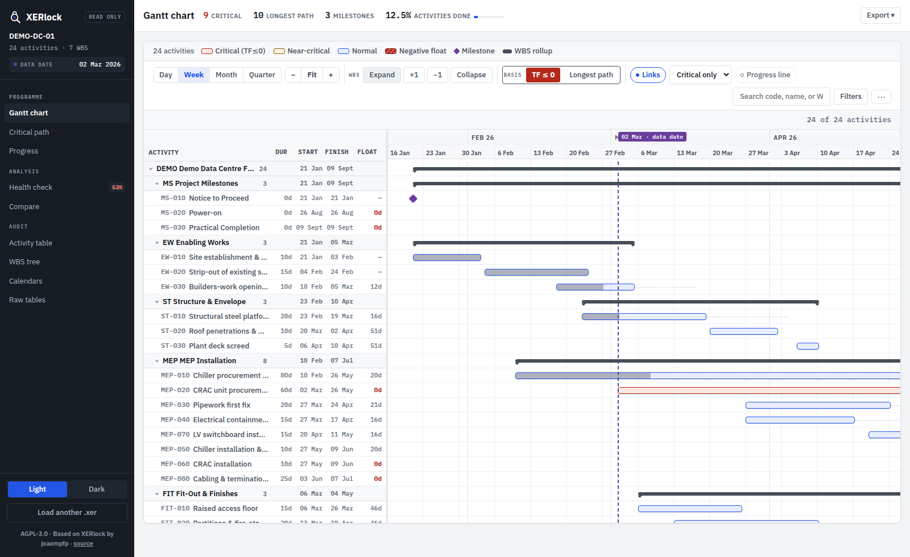
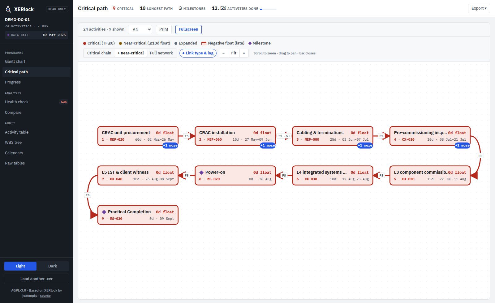
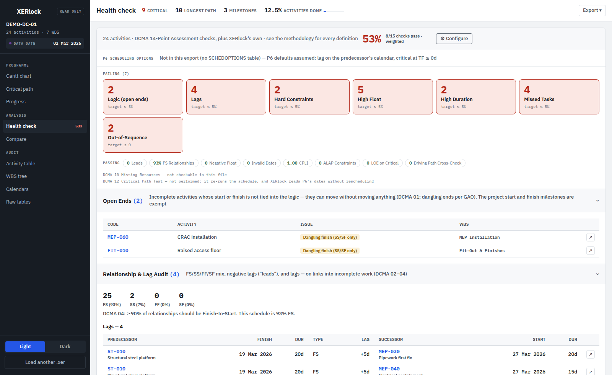
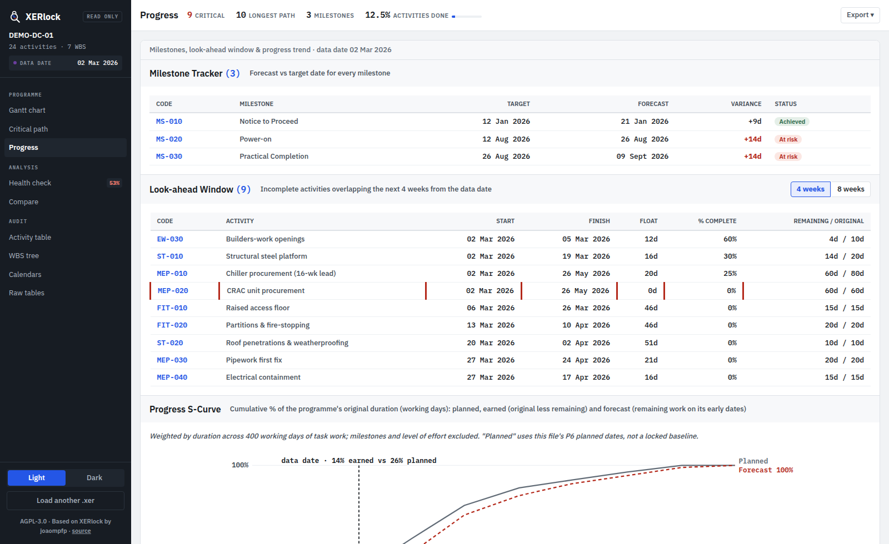
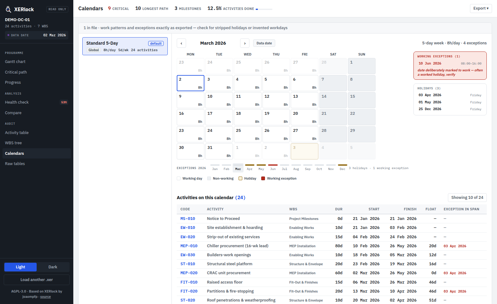
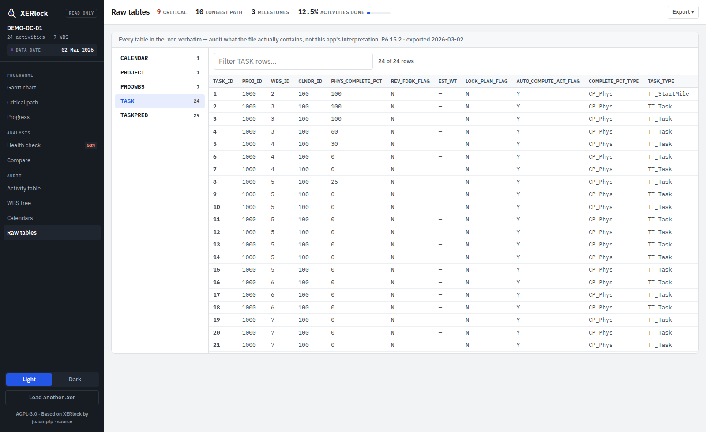

# XERlock

   

**Review a contractor's programme in full - without a P6 or Project licence.** Upload a P6 `.xer`
export, a Microsoft Project XML file or a `.mpp` and get
an interactive Gantt chart, a critical-path network diagram, configurable DCMA-14-style schedule
quality checks, calendar and raw-table inspection, progress tracking, and snapshot comparison -
everything a planner needs to review a schedule in detail, self-hosted so the file never leaves
your own infrastructure.

The name is the promise: XERlock is **locked read-only**. It never modifies, never re-saves, and
never stores your file - files are parsed in memory and discarded.

It is also, you will have noticed, a detective. Every programme arrives with a story - "the
critical path runs through commissioning", "we are on track for practical completion" - and
the clues are all in the file: a lag doing the work of a missing activity, a holiday quietly
removed from a calendar, an actual date that moved between two updates, a constraint
propping up a finish date. XERlock doesn't take the narrative's word for it. It reads the
evidence and shows its working. *Elementary* - though, unlike the original, it cites its
sources: every calculation is documented against the standard it follows in
[docs/METHODOLOGY.md](docs/METHODOLOGY.md).

**Try it in your browser: <https://joaompfp.github.io/xerlock/>** - nothing to install, and
your `.xer` never leaves your computer: it is parsed on your own machine, not uploaded. One
click loads a sample data-centre fit-out.

Built for project controls professionals: the checks follow the DCMA 14-Point Assessment, the
critical path follows P6's own definitions (AACE 49R-06), and every computed figure is either
P6's own value read from the file or recomputed in working time and cross-checked against it.
A CPM engine reschedules the whole programme in memory from its own logic, calendars,
constraints and progress; on the real submissions it was developed against it reproduces every
early and late date and every float P6 stored, and the recomputed Longest Path matches P6's on
every activity. [docs/METHODOLOGY.md](docs/METHODOLOGY.md) gives each figure's definition,
source standard, `.xer` fields, and known deviations.


*Critical-path links drawn above the bars - logic never hides behind unrelated activities. Chain
tracing rebuilds an activity's driving path link by link.*

## Features

**The shell** - a sidebar grouping the nine views as *Programme* / *Analysis* / *Audit*, with
the project, its data date and the Health Check score always in view. Light and dark themes,
both real, with the semantic state colours re-lit per theme so criticality never changes
meaning. Works down to a phone, where the sidebar slides over from a hamburger.

**Gantt Chart** - the primary view
- WBS-hierarchical activity grid with duration, start, finish and **float** columns, float
  colour-coded by the same severity bands as the bars
- Continuous zoom (presets + Ctrl/scroll), drag-pan, fit-to-width, resizable activity column
- Critical-path link overlay drawn *above* bars so logic never hides behind unrelated activities
- Two critical-basis modes: total float at or below the project's own critical threshold, or
  Longest Path - traced through driving links, where a link drives when its relationship free
  float is zero in working time, exactly as P6 defines it
- Progress line, today + data-date markers, weekend shading, filter bar (text/status/critical/constraint/review notes/
  activity codes/date window with 4- and 8-week look-ahead presets from the data date)
- Key dates and periods: your own labelled lines and shaded date ranges (client access,
  shutdowns, permit windows) in muted colours, on screen and on the printout
- Note callouts: click a review note's dot to show it on the chart, drag it where it reads best; it
  stays tied to its bar, is remembered in this browser, and prints
- Float tails: a dashed line off each bar end, proportional to total float, so slack is visible
  in the chart rather than a number to look up
- Baseline ghost bars: with a Compare baseline loaded, every activity draws a hollow bar at its
  baseline position - slips read as horizontal offsets, right in the Gantt
- Docked detail panel (it does not cover the chart): stat tiles, and a **driving chain** showing
  the driving predecessor, this activity, and the driving successor with the link type and lag
  per hop - click a node to walk the chain. What is not driving sits in collapsed lists, each
  link with its relationship free float, so every "driving" label can be checked by hand
- Printout that matches the screen: the Gantt as shown, fitted to the paper width, one sheet at a time with its own header

**Critical Path** - activity-on-node network diagram

- Dagre-based DAG layout folded into a "snake" so long chains stay readable
- Scope control: critical chain / + near-critical / full network; expand hidden neighbours on demand
- Nodes are name-led and ranked by position along the driving chain, so the diagram reads as a
  sequence; link type and lag are labelled on each edge (`FS`, `SS +5d`)
- Pan/zoom canvas with the same docked detail panel and jump navigation

**Health Check** - the DCMA 14-Point Assessment, plus checks of XERlock's own

- DCMA 01-11 and 13 to their published definitions and populations (incomplete work,
  excluding level-of-effort and WBS summaries): logic and dangling ends, leads, lags,
  relationship types, hard constraints, high and negative float, high duration, invalid
  dates, resources, missed tasks, and the **CPLI** computed in working time
- **DCMA 12 (Critical Path Test)**: 600 working days added to the first Longest Path activity
  with work left, the programme rescheduled in memory, and the project finish expected to move
  by the same amount; on failure, the activity where the delay was absorbed. Reported only when
  the **recalculation** reproduces the file's stored dates and float exactly
- **Recalculation matches the file**: a CPM engine with the file's own tool's rules (P6's, or
  Microsoft Project's since 1.3.0) recomputes early/late dates and float and compares them with
  the stored values, activity by activity and field by field - a difference means an edit
  without a reschedule, or a scheduling feature the engine declines to model (resource-dependent
  activities, cross-project links, multiple float paths on P6; manual, split, levelled or
  resource-driven tasks on Project; each refusal says why)
- Plus: out-of-sequence progress on FS, SS and FF links, ALAP constraints on the critical
  path, LOE on the critical path, and a **driving path cross-check** - P6's stored Longest
  Path against the one recomputed from the file's dates, which exposes a schedule that was
  edited and not recalculated
- **P6 scheduling options** shown first (Retained Logic vs Progress Override, float type,
  lag calendar, critical definition, expected finish dates): every date depends on them
- Every check names its source; failures are cards in the state colour, passes collapse into
  a quiet pill strip, and un-checkable items are a footnote with the reason
- **Configurable**: per-check include/exclude, thresholds, targets, and weights (contracts
  differ), defaulting to DCMA's; the weighted score is labelled as XERlock's roll-up, not a
  DCMA figure
- Every finding is one click away from the activity in the Gantt

**Progress** - status-date-anchored monitoring

- Milestone tracker with target-vs-forecast variance
- 4/8-week look-ahead window with remaining vs original durations
- Duration-weighted S-curve: planned, earned (original less remaining duration) and forecast,
  anchored to the data date

**Calendars** - the check most tools can't do without P6

- Month-by-month browser for every calendar in the file: weekly work patterns, holiday
  exceptions, and - highlighted loudly - **working exceptions**, i.e. dates deliberately marked
  to work that would normally be holidays. Stripped holidays and invented workdays are a classic
  way a programme gets quietly compressed, and they're invisible to date-based checks.
- Full exception register per calendar, plus which calendars are actually assigned to activities

**Raw Tables** - audit-grade file inspection

- Every table in the `.xer` exactly as exported (`TASK`, `PROJWBS`, `CALENDAR`, `TASKPRED`,
  UDFs, …) with filter, sort, pagination, and a per-row record view - verify what the submission
  actually contains rather than trusting any tool's interpretation (including this one's)
- Shows P6 version and export date from the file header; correct accented characters even for
  cp1252 exports

**WBS Tree** - roll-up per node
- Critical count, activity count, span and progress for every branch, aggregated from its
  descendants, so a branch's shape reads without expanding it

**Compare** - diff two `.xer` snapshots
- Leads with the verdict: project finish baseline → current with the day delta, then milestone
  dumbbell chart (baseline ● - ● current per milestone) and a slip tornado of the biggest
  movers - tables below for drill-down
- Date slips, duration edits, float erosion, critical-path churn (with a stability score),
  logic changes, added/removed activities
- **Forensic checks**: actual dates that moved or vanished between updates (as-built history
  should not change), and constraints added, removed or re-dated
- **Snapshot register**: save the current parse in the browser (IndexedDB) and diff
  against it next month - no need to keep old `.xer` files at hand; nothing leaves
  the browser
- Activities matched by code (stable across re-exports), not internal IDs

**Review workflow**
- Attach notes with severity tags (Query / Risk / Logic Issue / Resolved) to any activity;
  flags show across every view, persisted in your browser per project
- Export an annotated Review Report (.xlsx), a full schedule workbook, or filtered CSVs
- The app remembers your last opened file (browser-local) for one-click reopening

## Try it

The **Load the sample project** button on the upload screen loads a synthetic 24-activity
data-centre fit-out (realistic logic, a critical path, negative float, in-progress work) - the
same file ships in [`examples/sample-schedule.xer`](examples/sample-schedule.xer). The link
beside it loads the same project as Microsoft Project would save it
([`examples/sample-schedule.xml`](examples/sample-schedule.xml)).

## Microsoft Project files

Since 1.2.0 XERlock reads Microsoft Project files too: **Project XML** (File > Save As >
XML) in both builds, and **`.mpp`** (Project 98 to current) on the server, where
[MPXJ](https://www.mpxj.org) converts it to Project XML in memory. The standalone build has no
Java, so it asks for the XML. Every view and check works on them; the file's own stored
dates, slack, critical flags, actuals, Baseline 0, constraints and calendars are read, never
recomputed, and the checks that need a P6-only concept say "not checkable" and why. Project
adds its own checks: manually scheduled tasks, logic on summary tasks, elapsed and percentage
lags, inactive tasks. The recalculation and the Critical Path Test run with Project's own
scheduling rules, validated against Project's stored values on MPXJ's test corpus; a file that
rests on a rule the corpus has not validated is compared but keeps the test withheld, and the
Health Check names the rule. [`docs/METHODOLOGY.md`](docs/METHODOLOGY.md) ("Microsoft Project
files", "Recalculation of Microsoft Project files") maps every field, check and rule, with the
evidence for each decision.

## Architecture

```
┌────────────┐  file upload   ┌─────────────────────────────┐
│  Vue 3 SPA │ ─────────────▶ │ FastAPI backend              │
│  (Vite)    │ ◀───────────── │ readers: .xer (PyP6XER),     │
└────────────┘  parsed JSON   │ Project XML, .mpp (MPXJ)     │
                              └─────────────────────────────┘
```

- **Backend** (`backend/main.py`): FastAPI. One endpoint (`POST /api/upload`) picks the reader
  from the file's content (`backend/schedule.py`): `backend/xer.py` with
  [PyP6XER](https://pypi.org/project/PyP6XER/) for `.xer`, `backend/mspdi.py` (standard
  library only) for Project XML, `backend/mpp.py` with [MPXJ](https://www.mpxj.org) over JPype
  for `.mpp`. `backend/analysis.py` derives what both formats share (driving links, Longest
  Path, CPLI, WBS roll-ups) and returns the full schedule as JSON - activities with
  float/constraints/actuals/codes, the WBS tree, and project stats. **Nothing is persisted
  server-side**; files are parsed and discarded.
- **Frontend** (`frontend/`): Vue 3 (Options API) + Vite, in strict TypeScript; `src/types/schedule.ts` declares the API contract, and the build fails if it drifts from what the backend returns. No UI framework - hand-rolled CSS on a
  design-token system. [dagre](https://github.com/dagrejs/dagre) computes the network layout;
  [ExcelJS](https://github.com/exceljs/exceljs) (lazy-loaded) generates the Excel exports.
  Annotations and the last-opened file live in `localStorage` only.
- In production, FastAPI serves the built frontend from `frontend/dist/` - a single container
  runs everything. The container carries a headless JRE for MPXJ; running outside it, install
  a Java runtime (`JAVA_HOME`, or `java` on the path) to read `.mpp` files.

## Run locally

Requires Python ≥ 3.10 and Node ≥ 18.

```bash
# backend
python3 -m venv .venv
.venv/bin/pip install -r requirements.txt
.venv/bin/uvicorn backend.main:app --reload --port 8000

# frontend (separate terminal)
cd frontend && npm install && npm run dev
```

Open http://localhost:5173 - the dev server proxies `/api` to the backend on port 8000.

## Standalone build: parse in the browser, no server

```bash
cd frontend && npm install && npm run build:standalone    # -> frontend/dist-standalone/
```

The same Python parsing core the server runs (`backend/xer.py`, `backend/mspdi.py`,
`backend/analysis.py`) runs in the browser under [Pyodide](https://pyodide.org), in a Web
Worker; `.mpp` files need Java and so the server, the page says to save them as XML. The output is plain static files: host them
anywhere that serves files over HTTP (GitHub Pages, an intranet web server, any static host);
there is no backend. **The file never leaves the user's computer**, so parsing works with
the network disconnected once the page has loaded. Everything is served from the app's own
origin: no CDN, nothing for a corporate proxy to block. The first visit downloads about 6.5 MB
(measured on GitHub Pages) for the Python runtime; the browser caches it afterwards. Results are identical to the
server's: the test suite and CI build both modes.

A hosted copy is published at <https://joaompfp.github.io/xerlock/>, rebuilt from `main` on
every push. To host it yourself (e.g. on an intranet web server), download
`xerlock-standalone-<version>.zip` from the [releases](https://github.com/joaompfp/xerlock/releases)
and serve its contents at the root of a site. To serve it under a sub-path, build it with
`npm run build:standalone -- --base=/your/path/`.

## Deploy

**Docker (recommended):**

```bash
cd frontend && npm install && npm run build && cd ..
docker compose up -d --build
```

Or without compose:

```bash
docker build -t schedule-app .
docker run -d -p 8000:8000 schedule-app
```

The container serves the whole app on port 8000. Put your reverse proxy of choice
(Traefik, Caddy, nginx) in front for TLS.

> The frontend must be built (`npm run build`) *before* the image build - the Dockerfile copies
> `frontend/dist/` rather than running Node inside the image, keeping it a slim single-stage
> Python image. If you prefer building inside Docker, a multi-stage
> `node:20-alpine → python:3.12-slim` Dockerfile works too.

## Tests

```bash
pip install -r requirements-dev.txt && pytest        # backend: parser, calendars, API
cd frontend && npm install && npm run test:run       # frontend: pure utils, geometry
```

The backend suite pins the numerically load-bearing behaviour - working-time arithmetic on P6
calendars, the driving rule and its agreement with P6's own Longest Path, the CPLI hand
calculation, % complete per P6 type, float/day conversion, the display-date convention,
calendar exception decoding, every CPM engine rule on a minimal network and exact reproduction
of the sample - plus the API contract, including that no uploaded file survives the request.
`tests/test_mspdi.py` pins every Microsoft Project mapping rule on minimal XML documents and
the agreement of the two samples; `tests/test_mpp.py` the `.mpp` conversion (skipped without
Java; CI installs a JRE). The frontend suite tests each health-check rule on a minimal
synthetic schedule. Both suites run on every push (`.github/workflows/test.yml`).
`scripts/cpm_oracle.py` checks the engine against your own P6 exports and prints match counts
only, never activity content; `scripts/fetch_msp_corpus.sh` and `scripts/msp_corpus.py` run
the Project readers over MPXJ's test corpus and report aggregates.

## Development notes

- All colors/typography/spacing are CSS custom properties defined once in `App.vue` (`:root`
  block). Semantic status colors (`--crit`, `--near`, `--ok`, `--ms`) mean the same thing in
  every view, in both themes - don't introduce new colors for criticality states.
- A class used by more than one component belongs in `App.vue`'s global block. Left in a
  component's `scoped` block it silently renders unstyled everywhere else, with nothing in the
  console - this has bitten `.btn-tiny-light`, `.btn-tiny`, `.ctrl-btn` and `.tb-chip`.
- The Gantt deliberately avoids `position: sticky` for its frozen header/label column
  (Chromium mis-renders sticky grid items near scroll boundaries); positions are tracked
  manually from the scroll handler. See comments in `GanttChart.vue`.
- Numeric text (codes, dates, durations, floats) renders in tabular monospace app-wide.
- Timeline maths lives in `utils/ganttGeometry.ts` and paper sizes in `utils/paper.ts`,
  both pure and unit-tested; `mixins/fullscreen.ts` carries the fullscreen lifecycle shared
  by the two charts. The charts' pan implementations are deliberately *not* shared — the
  Gantt pans a scroll container, the network diagram pans an SVG transform.
- `docs/DESIGN_TOKENS.md` is the reference for the design system (generated from `App.vue`:
  every token, its value, which themes override it, and which components consume it).

## Contributing

Issues and pull requests are welcome; see [CONTRIBUTING.md](CONTRIBUTING.md) and the
[code of conduct](CODE_OF_CONDUCT.md). Report security problems privately as described in
[SECURITY.md](SECURITY.md).

## License

[GNU AGPL-3.0-or-later](LICENSE), with one additional term under section 7(b): derivatives must
keep the author attribution "Based on XERlock by joaompfp" in their UI and documentation (see
[NOTICE](NOTICE)). In short: you may use, modify, self-host and redistribute XERlock freely; if you
distribute a modified version or offer it to others over a network, you must publish your source
under the same licence. Commercial licences without these conditions are available from the author.
Versions published before 12 October 2026 remain available under MIT.

Depends on [PyP6XER](https://pypi.org/project/PyP6XER/) (LGPL-2.1, used as an
unmodified library), dagre, ExcelJS, Vue, and IBM Plex fonts (OFL, bundled via Fontsource - the app makes no third-party requests).

Primavera and P6 are trademarks of Oracle. This project is not affiliated with or endorsed by
Oracle; it merely reads the documented `.xer` interchange format.
